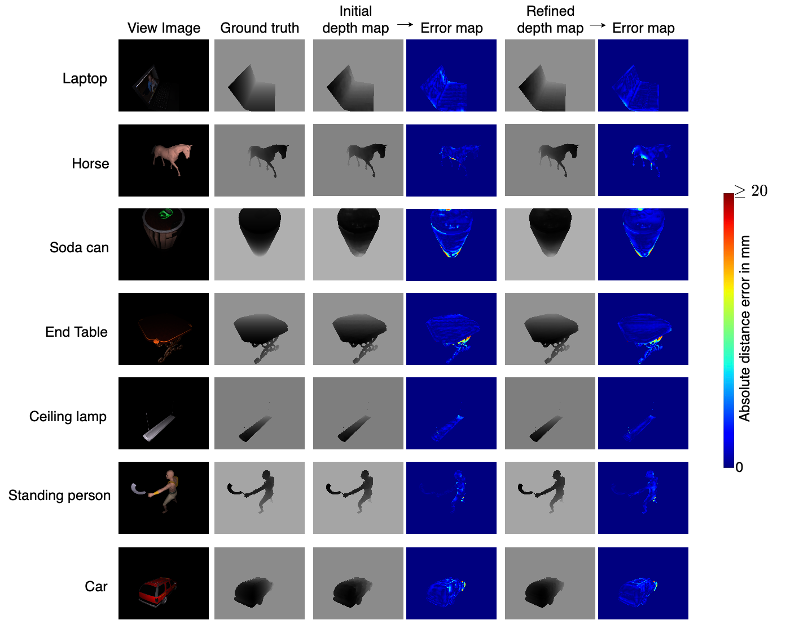
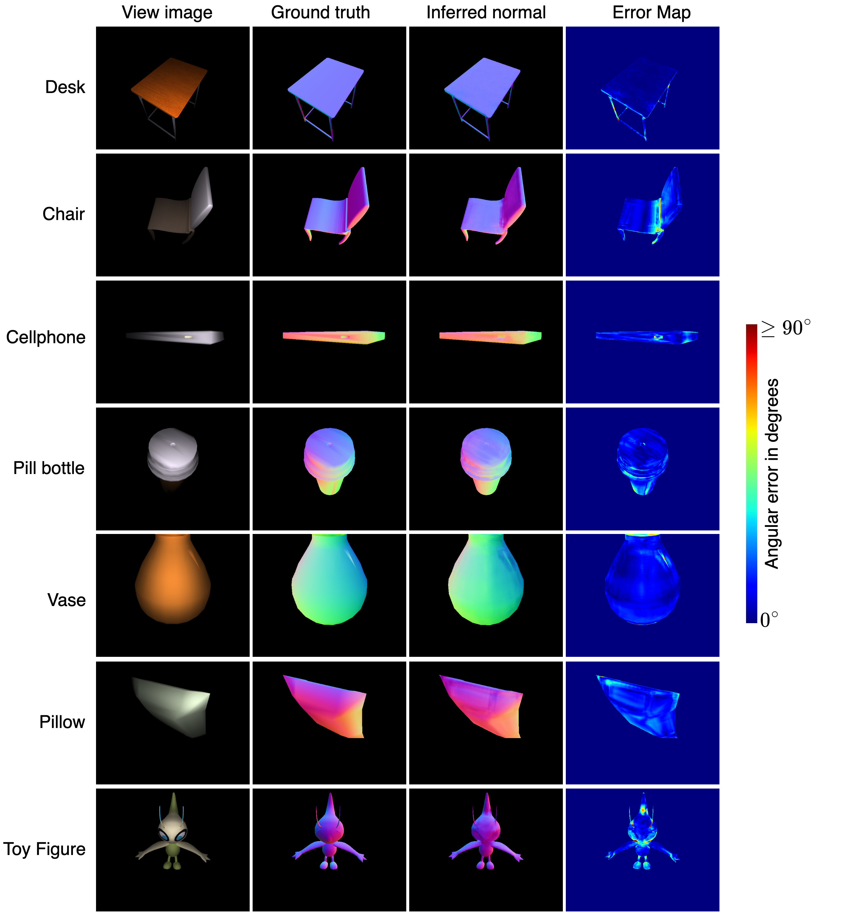

# Deep 3D Reconstruction of Scenes with Complex Surface Materials

MSc dissertation (Distinction) — University of Surrey, 2022  
**Author:** Opemipo Adegbemi · **Supervisor:** Dr. Jean-Yves Guillemaut  
**PDF:** [dissertation.pdf](./dissertation.pdf)

## Problem

Helmholtz Stereopsis can reconstruct scenes with **arbitrary / unknown BRDFs** by using reciprocal camera–light image pairs, unlike standard multi-view or photometric stereo, which assume Lambertian surfaces or known reflectance. The practical bottleneck is the cumbersome physical capture setup.

## Approach

1. **Synthetic Helmholtz dataset** — Render ShapeNetSem models in Blender Cycles with a controlled single-light, reciprocal camera–light setup (Blender Python API).
2. **Deep Helmholtz MVS** — Adapt [UCSNet](https://arxiv.org/abs/1911.12012) to estimate depth from reciprocal pairs.
3. **Deep Helmholtz photometric stereo** — Adapt [PS-FCN](https://arxiv.org/abs/1807.08696) to estimate surface normals from reciprocal pairs.

## Results (highlights)

| Item | Value |
|---|---|
| Models rendered | **4,676** (ShapeNetSem) |
| Views / model | **8** (up to **4** reciprocal pairs per view) |
| Training images | **29,928** (80/10/10 split) |
| Test views | **3,736** |
| Depth accuracy (adapted UCSNet, \(d_T=2\)) | **~59%** on full test set (improves with more reciprocal pairs) |
| Normal MAE (adapted PS-FCN) | **26.8°** average (≈**4–10°** on simpler objects) |

### Qualitative results

**Depth estimation (adapted UCSNet)** — view image, ground truth, initial / refined depth maps, and absolute error (mm):



**Surface normals (adapted PS-FCN)** — view image, ground-truth normals, inferred normals, and angular error (°):



## Stack

PyTorch · OpenCV · Blender / Cycles · NumPy · Matplotlib · multi-GPU training (RTX 3090 / Quadro RTX 5000)

## Quickstart

### Requirements

* Python ≥ 3.6
* CUDA capability ≥ 6
* `opencv-python==4.5.5.62`
* `numpy`, `ray`, `hpbandster`, `ConfigSpace`, `gputil`

### Dataset

Build the dataset before training (details in the dissertation PDF).

### Training / testing

```bash
# Training
Deep_Helmholtz/scripts/train.sh

# Testing
Deep_Helmholtz/scripts/test.sh
```

Related scripts: `scripts/train_mvs.sh`, `scripts/train_mvs2.sh`, `scripts/train_ps.sh`

## Citation

If you use this work, please cite the dissertation:

> Opemipo Adegbemi. *Deep 3D Reconstruction of Scenes with Complex Surface Materials*. MSc dissertation, University of Surrey, 2022.
